<!-- ============================== ENCABEZADO ============================== -->
<p align="center">
  
</p>

<p align="center">
  <a href="https://smyl0.github.io">
    
  </a>
</p>

<p align="center">
  <a href="https://smyl0.github.io"></a>
  <a href="https://www.linkedin.com/in/steven-pallo-b2717340a"></a>
  <a href="mailto:stevenpallo1025@gmail.com"></a>
</p>

<p align="center">
  
  
  
</p>

<p align="center">
  
</p>

<!-- ============================== SOBRE MÍ ============================== -->
## 👨‍💻 Sobre mí

- 🎓 Estudiante de **Ingeniería en Software** en la **Universidad Técnica de Ambato**, actualmente en **4.º semestre**.
- 💻 Desarrollo aplicaciones **web y de escritorio**: backend con **Java, C# y .NET**, interfaces con **React** y sitios dinámicos con **PHP**.
- 🧠 Me gustan las **estructuras de datos** y los algoritmos: listas enlazadas, árboles BST, recorridos y más.
- 🎮 Programé un **Tower Defense en C++ con raylib** donde torres, enemigos y oleadas viven en listas enlazadas.
- 🌐 Diseño y simulo **redes** con **Cisco Packet Tracer** y me muevo con soltura en **Linux**.
- 📫 ¿Hablamos? Escríbeme a **stevenpallo1025@gmail.com**

<details>
<summary><b>🔍 Haz clic para ver mi perfil en código</b></summary>
<br/>

```csharp
public class StevenPallo
{
    public string Carrera     => "Ingeniería en Software";
    public string Universidad => "Universidad Técnica de Ambato";
    public int    Semestre    => 4;
    public string Ubicacion   => "Ambato, Ecuador";

    public string[] Lenguajes    => new[] { "Java", "C#", "C++", "Python", "PHP", "JavaScript", "SQL" };
    public string[] Web          => new[] { "HTML", "CSS", "React", ".NET" };
    public string[] Herramientas => new[] { "Git", "Linux", "Cisco Packet Tracer" };

    public string Mision() => "Convertir ideas en software que resuelva problemas reales 🚀";
}
```

</details>

<!-- ============================== TECH STACK ============================== -->
## 🛠️ Tech Stack

<div align="center">
<table>
  <tr>
    <td align="center" width="190"><b>💻 Lenguajes</b></td>
    <td></td>
  </tr>
  <tr>
    <td align="center"><b>🌐 Web y Frameworks</b></td>
    <td></td>
  </tr>
  <tr>
    <td align="center"><b>🗄️ Bases de datos</b></td>
    <td></td>
  </tr>
  <tr>
    <td align="center"><b>🔧 Herramientas y Redes</b></td>
    <td>&nbsp;</td>
  </tr>
</table>
</div>

<!-- ============================== ESTADÍSTICAS ============================== -->
## 📊 Estadísticas en GitHub

<div align="center">
  
  
  
  
</div>

<!-- ============================== PROYECTOS ============================== -->
## 🚀 Proyectos destacados

| Proyecto | Descripción | Stack |
|:--|:--|:--:|
| 🏰 **[Tower Defense](https://github.com/Smyl0/Tower_Defense_Estructura_Datos)** | Juego con interfaz gráfica donde torres, enemigos y oleadas se gestionan con listas enlazadas. |   |
| 🎓 **[Sistema Académico UTA](https://github.com/Smyl0/Prueba-practica-arboles-java)** | Gestión de estudiantes con un Árbol Binario de Búsqueda: inserción, búsqueda, eliminación y recorridos (inorden, preorden, postorden y por niveles). |  |
| 👥 **[Gestión de Estudiantes](https://github.com/Smyl0/Proyectos_Estructura_Datos)** | Gestor de calificaciones con lista doblemente enlazada, más ejercicios de listas secuenciales. |  |
| 🌳 **[Ejercicios de Árboles](https://github.com/Smyl0/Deberes_Estructura_Datos)** | Árboles binarios, recorridos y transformaciones en Java y C++, además de un BST aplicado a una empresa. |   |
| 🏥 **[Registro de Pacientes](https://github.com/Smyl0/Deber_Registro_Pacientes_Atendidos)** | Programa de consola en C++ para llevar el registro de los pacientes atendidos. |  |
| 🌐 **[Portafolio web](https://smyl0.github.io)** | Mi portafolio personal con terminal interactiva, animaciones y datos en vivo desde la API de GitHub. |    |

<!-- ============================== ACTIVIDAD ============================== -->
## 🐍 Mi actividad

<p align="center">
  <picture>
    <source media="(prefers-color-scheme: dark)" srcset="https://raw.githubusercontent.com/Smyl0/Smyl0/output/github-snake-dark.svg" />
    <source media="(prefers-color-scheme: light)" srcset="https://raw.githubusercontent.com/Smyl0/Smyl0/output/github-snake.svg" />
    
  </picture>
</p>

<!-- ============================== PIE ============================== -->
<p align="center">
  <i>“El código es como el humor: si tienes que explicarlo, es malo.”</i> — Cory House
</p>

<p align="center">
  
</p>
